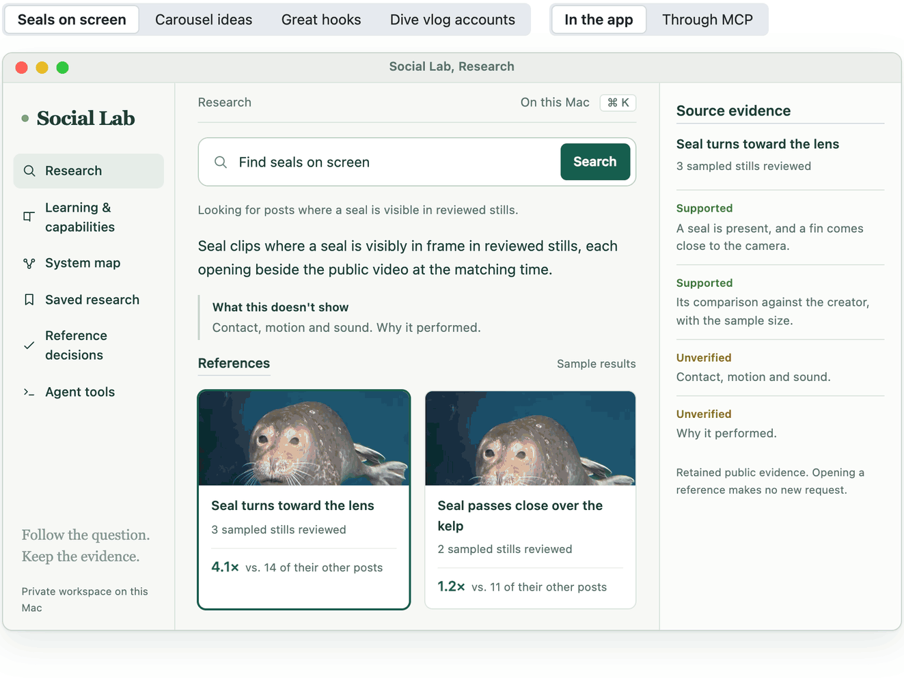
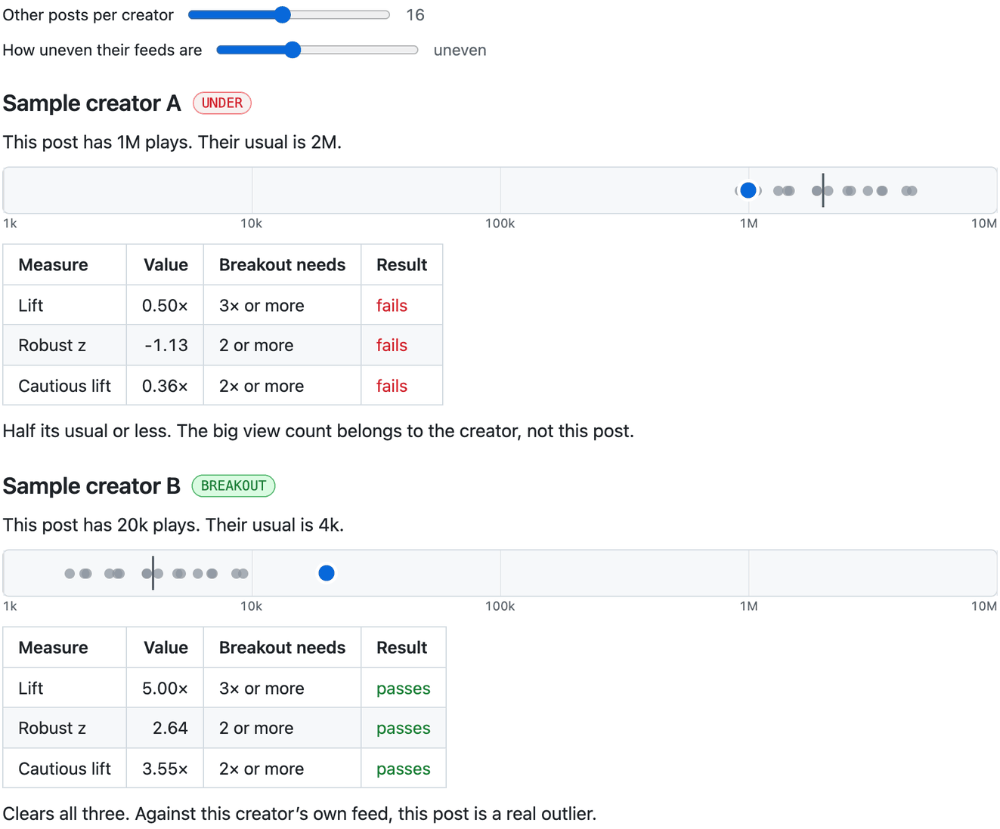

# Reef Social Lab

**Ask what's working underwater, and get references you can check.** I post dive footage as lensofcoop. Social Lab finds real public posts for what I'm making, then answers two questions about each one separately: did it actually beat its creator's usual, and does it actually show what I asked for. Every claim links back to the post, the frame or the number behind it.

Built with Python 3.13, a local web app, a CLI and an MCP server. Public discovery runs through Social Crawl and Apify, and keys stay in the macOS Keychain at runtime.

## Ask it something

The same research service answers in the app and through MCP, from the same retained evidence. The loop asks four questions, each in the app and then through MCP.

A rebuild of the Research workspace, not a screen capture, using the app's own layout, colors and wording. The questions are ones I asked. The references are samples, with my own footage standing in for other creators' posts, because the real research uses their public posts and the portfolio shows the method, not their numbers. Tool names and parameters are the MCP server's own. Search, answer, reference, compare and watch_context are marked read-only.

## Which post actually outperformed?

A million views sounds like a hit. But if that creator's posts usually get two million, it underperformed. Twenty thousand views from someone who usually gets four thousand is the real breakout. So every post is scored against the **other** posts from the same creator, never against itself, and the score has to survive uncertainty before it counts.

Plays on a log scale. Grey dots are the creator's other posts, the line is their median, and blue is the post being scored. Both feeds are synthetic, and the scoring is a port of <code>scoring.py</code>. The resampler is a JavaScript port, so its exact draws differ from Python's.

**Lift** is plays divided by the median of the creator's other posts. **Robust z** is (ln plays − median ln plays) ÷ (1.4826 × MAD), so one viral outlier can't distort the baseline. **Cautious lift** resamples the other posts 2,000 times with a fixed seed and divides by the 95th-percentile median, the most generous baseline the data allows. A breakout needs all three. Under ten other posts, it refuses to score. Lift doesn't adjust for how old a post is, and it never explains why a post did well.

## Popular isn't the same as useful

A breakout post can still be a bad reference for a slow kelp-forest encounter. So relevance is a second question with its own evidence, and every reference says how deeply it was actually checked. The agent can't claim a level it hasn't reached.

- [x] **Metadata.** Caption, hashtags, duration, dates and recorded numbers from the original post. **
- [x] **Creator comparison.** The target against the same creator’s other eligible posts, with its sample size shown. **
- [x] **Provider transcript.** Exact recovered text, without timestamps. Opening it makes no new request. *Attached, not verified.*
- [x] **Sampled stills, reviewed.** Frames looked at one by one, each with literal observations and the time it came from. **
- [x] **Whole video and sound.** Motion, pacing and audio. Until this exists, nothing gets called an excellent hook. *Not built yet.*

## One service, three ways in

The local web app, the CLI and the MCP server all call the same research service and read the same retained evidence. In the app, follow-ups keep their context, and *Watch with evidence* plays a public video beside its sampled frames at the exact time. Through MCP, `social_lab_answer` doesn't secretly call a language model. It returns the supported facts and says what it couldn't support.

| Rule | How it's enforced |
| --- | --- |
| Public search runs only when I ask | Discovery is a separate, paid tool. Everything else reads retained evidence and makes no request. |
| A real budget | A durable 30-credit allowance that a restart doesn't reset. A breakout question may spend up to 12 credits, anything else up to 4, and callers can't raise either limit. |
| No silent retries | After a lost response, the caller reuses the same request ID. Nothing retries automatically. |
| Nothing private goes out | Discovery takes public search terms only, never my footage, briefs, notes or credentials. |
| Lossless proof | Big answers store each source document once, keyed by the SHA-256 of its canonical JSON. That's deduplication, not summarizing. |

## What it keeps

In *Reference decisions* I compare a reference's request fit, measured performance and inspection evidence, then mark it Explore, Maybe or Pass with a note. Each save freezes that exact evidence, so reopening it after a restart shows what I saw then. New reviewed references can change which results come first. **My verdicts are kept and shown again, but they don't train a taste model.** That loop isn't built, and the app says so.

## Inside

- A research service behind a local web app, a CLI and an MCP server, all reading the same retained evidence
- Creator-relative scoring: leave-one-out median lift, log/MAD robust z, a seeded 2,000-draw bootstrap
- Public discovery through Social Crawl, run only when I ask, with a durable credit ledger
- Sampled-frame review with exact-time playback, and provider transcripts kept as unverified attachments
- Saved research and reference decisions that freeze their evidence snapshot
- A bridge packet that gives Reef six read operations: capabilities, search, answer, reference, compare and audio\_references
- 2,127 Python cases and 258 JavaScript tests at `b578f74`

## Notes

Still open: full-video motion and audio inspection, and qualifying an "excellent" dive vlog, which needs both a real creator comparison and an inspected clip. A direct-video Gemini runner passes its tests and a real token count, but Google rejected generation (HTTP 402), so no model has inspected a whole video yet. Reef's per-chat adapter for the bridge isn't built. The source is private. The scorer is written up as an interactive study in [reef-algorithm-studies](https://github.com/henryhcooperr/reef-algorithm-studies).

## Collection, October 2026

- 2,180 public posts
- 48 playable references
- 72 annotated sampled frames
- 2 carousels, every image reviewed

## Related

- [henryhcooperr profile](https://github.com/henryhcooperr)
- [reef, where references end up](https://github.com/henryhcooperr/reef)
- [coopr, a different creator workspace](https://github.com/henryhcooperr/coopr)
- [reef-algorithm-studies](https://github.com/henryhcooperr/reef-algorithm-studies)
